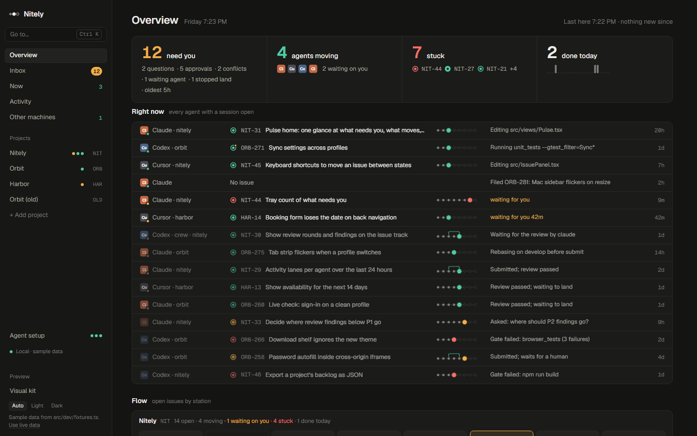
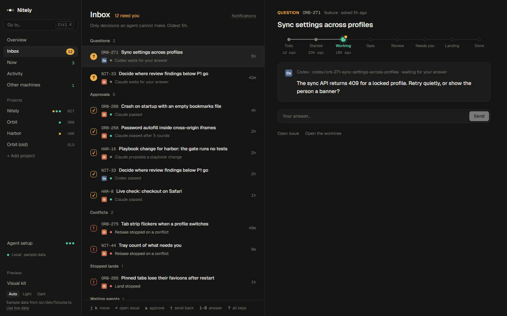

# Nitely

[](https://github.com/frontiermaxxing/Nitely/actions/workflows/ci.yml)
[](LICENSE)

**One person, a team of coding agents.** Nitely is a desktop app and a command-line tool for
running Claude Code, Codex and Cursor agents across several repos at once. It gives them one
backlog to take work from and one set of rules for branches, tests, reviews and merging. It shows
you what each agent is doing right now. An inbox holds the decisions only you should make.



## What it does

- **A backlog agents work from.** Each project has its own issues (`APP-12`) with kind, priority,
  evidence and a full timeline. Agents claim the most urgent one with `next_task`, so two agents
  never start the same issue. They report as they go and leave a handoff note when they stop.
- **The same workflow for every agent.** A repo's playbook (`.nitely/playbook.toml`) says how a
  task becomes work: its branch and worktree, the gate that must pass, which vendor reviews whose
  work, which changes wait for you, and how landing works. `start_task`, `submit` and `land` run
  it, the same way for every vendor.
- **Cross-vendor review.** Codex reviews Claude's branches and Claude reviews Codex's (or whatever
  you set). A review with serious findings sends the work back. A change that touches paths you
  care about (billing, releases) waits for you.
- **One merge at a time.** `land` is the only writer of the integration branch. It holds a lock,
  rebases, checks that the review covers exactly this change, runs the gate, then fast-forwards
  and pushes.
- **A live view of every agent.** Overview, Now and Activity show which agent works on what, what
  it last did, and what is stuck. Hooks report tool calls, commands and file paths, never your
  prompts or file contents.
- **Only real decisions reach you.** The Inbox holds agents' questions, approvals, conflicts and
  stopped lands. Approving and answering happen only in the app: no command or tool an agent can
  run does either.
- **Optional: Nitely runs the agents.** A project's crew keeps a set number of headless agents
  working through its backlog, within daily limits and quiet hours ([docs/crew.md](docs/crew.md)).



## Install

Nitely runs on Windows today; macOS is next. Builds are published on
[GitHub Releases](https://github.com/frontiermaxxing/Nitely/releases): stable releases, plus beta and
nightly pre-releases ([docs/releasing.md](docs/releasing.md)); until the first stable release, the
nightly is the one to try. Its `Nitely_*_x64-setup.exe` needs no administrator rights and puts the
`nitely` command where your agents find it.

The installer is not code-signed, so Windows SmartScreen warns the first time you run it: choose
**More info**, then **Run anyway**. To check a download first instead of trusting the warning
away:

- **Tagged releases** (stable and beta) carry a GitHub build attestation: proof, signed through
  Sigstore, that this repository's release workflow built the file from that tag. With the
  [GitHub CLI](https://cli.github.com):

  ```powershell
  gh attestation verify .\Nitely_0.1.0_x64-setup.exe -R frontiermaxxing/Nitely
  ```

- **Every release**, the nightly too, has `SHA256SUMS.txt`. Compare your file's hash with its line:

  ```powershell
  (Get-FileHash .\Nitely_0.1.0_x64-setup.exe).Hash.ToLower()
  ```

Or build it from source, which needs no trust in a download at all.

To build it from source:

1. Install [Rust](https://rustup.rs) (MSVC toolchain), [Node.js](https://nodejs.org) 20 or newer,
   and Visual Studio Build Tools with "Desktop development with C++". WebView2 ships with Windows 11.
2. Build and install:

   ```powershell
   git clone https://github.com/frontiermaxxing/Nitely.git
   cd Nitely
   npm install
   cargo run --release -p nitely-cli -- install    # puts nitely.exe on your PATH
   npm run tauri build                             # the app and its installers, in target/release/bundle
   ```

   `npm run tauri dev` runs the app from source with hot reload instead.

   Source installation requires committed Rust sources and Cargo files. It takes the landing
   lock and runs Cargo once more with an explicit commit stamp before replacing the installed
   binary. If another land or install is active, wait for it to finish and rerun the command.
   The candidate must also support your current database; a refusal keeps the installed copy.

## Quick start

1. **Connect a repo you already work in.** In the app, choose **+ Add project**, or run:

   ```powershell
   nitely connect C:\Code\my-app          # shows what it will do
   nitely connect C:\Code\my-app --yes    # does it
   ```

   This creates the project, watches the repo and its worktrees, keeps a playbook for it, and
   connects every agent it finds at user level (MCP server, hooks, instructions). Nothing is written
   into the repo. Details: [docs/setup.md](docs/setup.md).
2. **Seed the board.** In the repo, ask an agent to set it up: `/nitely-setup` in Claude Code; in
   Codex or any other agent, "call the nitely `setup_guide` tool and follow it". It sweeps the repo
   read-only, files what it finds, writes the project's brief and proposes review rules, which you
   approve in the Inbox. (Codex from the Microsoft Store isn't on PATH; Nitely finds it anyway.)
3. **Let agents work.** Tell an agent to take the next task, or let Nitely run them: add a crew to
   the project's playbook (the Rules tab shows where it is), and it keeps that many agents working
   through the backlog ([docs/crew.md](docs/crew.md)):

   ```toml
   [crew]
   workers = 1
   agents = ["claude", "codex"]   # preference order; ones not installed are skipped
   ```

   Watch Overview, answer the Inbox, and approve what waits for you.
4. **Answer from your phone.** **Phone** in the sidebar pairs a phone over Tailscale; a paired phone
   answers the agents' questions and approves their changes, and nothing else
   ([docs/phone.md](docs/phone.md)).

## What agents get

`nitely mcp` is an MCP server, registered for each agent by `nitely connect`:

| Tools | What they do |
| --- | --- |
| `next_task`, `start_task` | Claim the most urgent issue; create its branch and worktree and run setup |
| `widen` | Add directories to a sparse light worktree (`[worktree] mode = "light"`, docs/build-lanes.md) |
| `report`, `note`, `ask`, `get_answer` | Say what they are doing, leave handoffs, ask you something |
| `request_acceptance` | Ask you to accept one review finding as it is (a trade-off you decided), signed when you do |
| `file_issue`, `file_issues`, `update_issue`, `get_issue`, `list_issues` | Work the backlog (evidence required; Done needs proof; only you approve) |
| `run_gate`, `submit`, `land` | Run the gate; hand in a branch for review and a pull request; merge it |
| `setup_guide`, `get_project`, `set_project_brief`, `mark_setup_complete` | Set up a project and keep its brief |
| `propose_playbook_change` | Suggest a rule change for you to apply or reject |
| `goals`, `save_goal` | Group issues under an outcome and see how far along each goal is (`goal` on filing and updates) |
| `propose_goal` | Draft a goal and its issues from your sentence, for you to approve (and edit) in the Inbox |

Every command has a CLI twin (`nitely submit`, `nitely land APP-4`, ...); `nitely --help` lists them.

## More

- [Setting up a repo](docs/setup.md): what connecting writes, agent instructions, hooks.
- [Playbooks](docs/playbooks.md): branches, gates, reviews, approvals, landing, and private terms
  that must never reach a repo. [A worked example](docs/playbooks/example.toml).
- [GitHub, Bitbucket and Linear](docs/integrations.md): pull requests, checks and the one-time move
  off Linear.
- [Agents on other machines](docs/other-machines.md): share this machine's backlog on your network.
- [Signed approvals](docs/approvals.md), [the crew](docs/crew.md), [the phone](docs/phone.md), and
  where Nitely is going ([docs/vision.md](docs/vision.md)).

With many agents building on Windows, a Defender exclusion or a Dev Drive can make builds faster;
neither is needed ([docs/setup.md](docs/setup.md#faster-builds-on-windows-optional)).

Nitely keeps its data in `%APPDATA%\Nitely` (`nitely where` prints it): a SQLite database, its
config, and the playbooks it keeps for repos that have none.

## Building on Nitely

| Path | What |
| --- | --- |
| `crates/nitely-core` | Issues and their rules, playbooks, review, land, git, sync, the SQLite store |
| `crates/nitely-cli` | The `nitely` binary: CLI, MCP server, hooks |
| `src-tauri` | The Tauri 2 desktop shell |
| `src` | The React + TypeScript frontend; `npm run dev` runs it on sample data in a browser |

The gate is `cargo test --workspace`, `cargo clippy --workspace -- -D warnings`, `npm test` and
`npm run build`; CI runs it on every pull request. Nitely builds itself: its backlog is the NIT
project, and [AGENTS.md](AGENTS.md) is how agents work on this repo.

## Contributing

Issues and pull requests are welcome; [CONTRIBUTING.md](CONTRIBUTING.md) says how. Commits need a
`Signed-off-by` line (`git commit -s`, the Developer Certificate of Origin).

## License

Copyright 2026 Quixet LLC. Licensed under the [Apache License 2.0](LICENSE); see [NOTICE](NOTICE).
A Nitely build includes open-source packages under their own licenses, listed in
[THIRD-PARTY-NOTICES.md](THIRD-PARTY-NOTICES.md). Claude, Codex and Cursor are their owners'
trademarks; Nitely is not affiliated with them.
