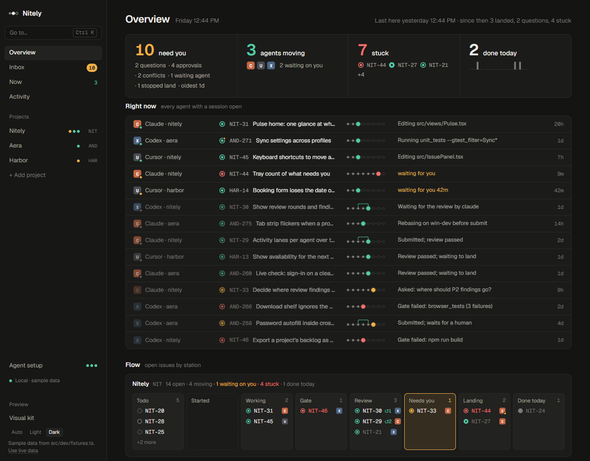
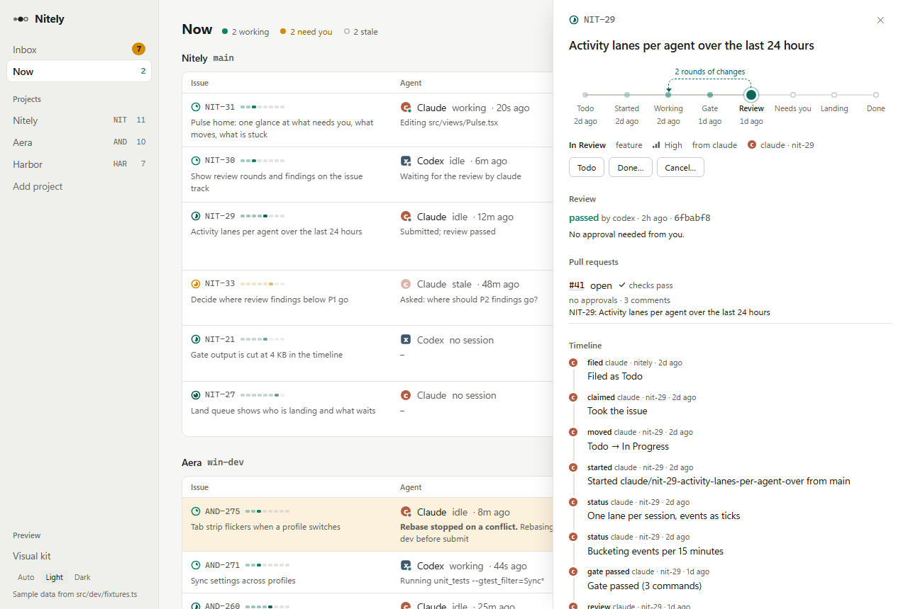
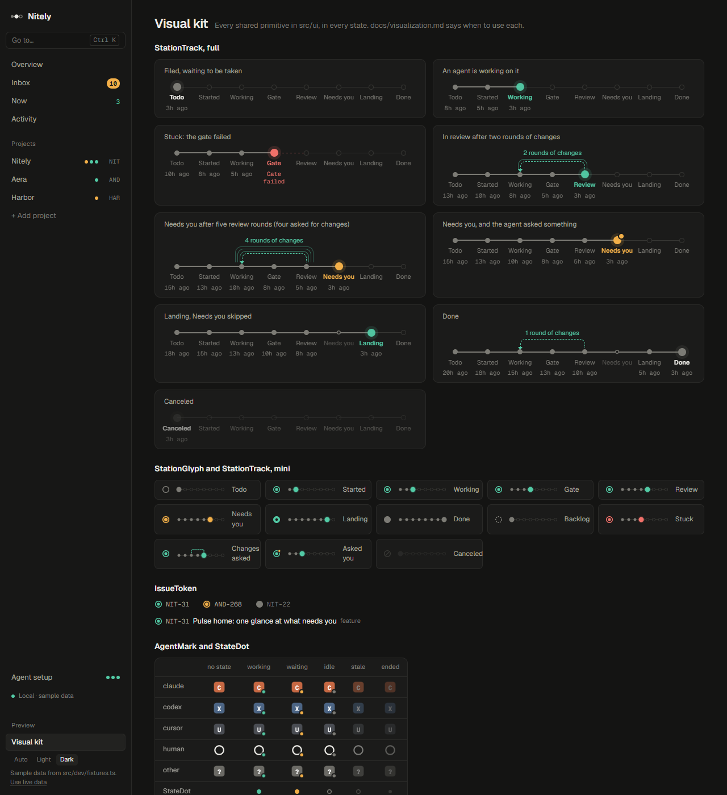
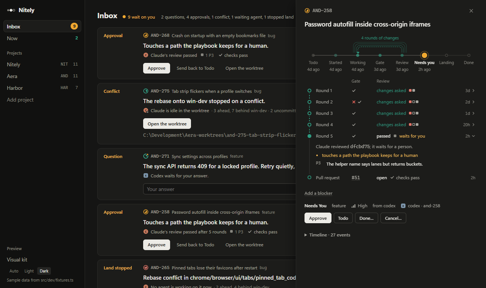
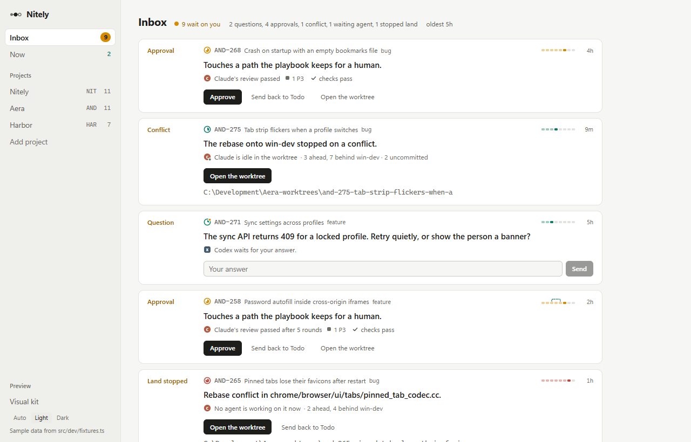
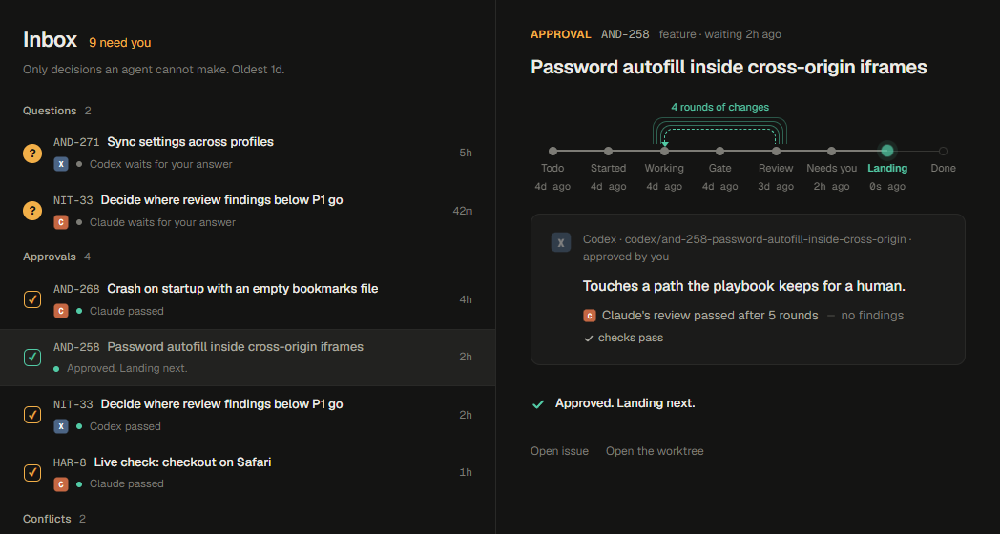
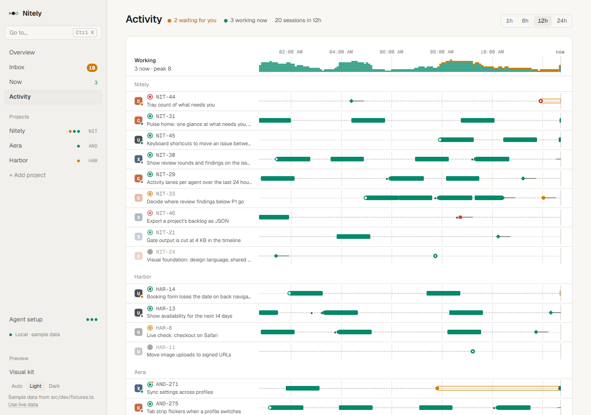
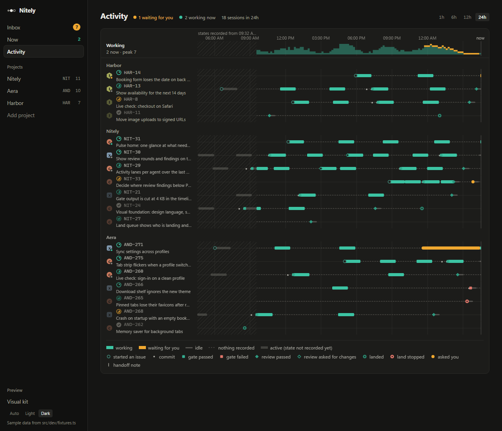
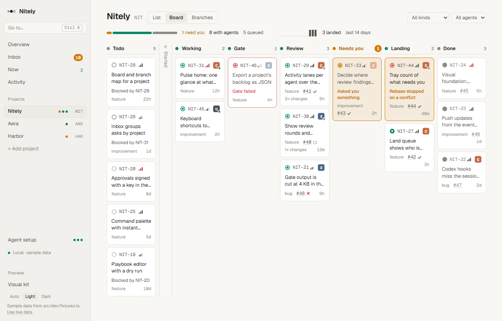
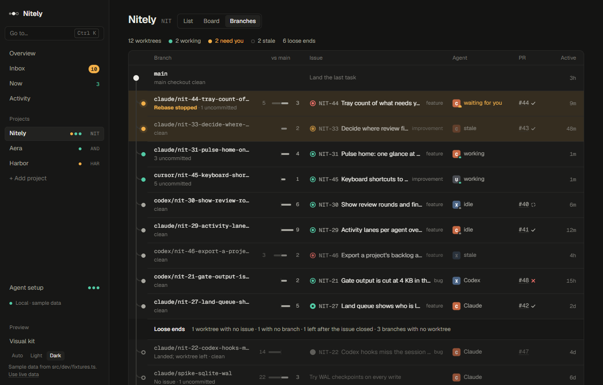

# Visualization: how Nitely shows work

**Status:** set by NIT-24, 2026-10-16; redrawn by NIT-61 to the "Nitely Redesign" (Claude
Design, 2026-10-16). Every view builds on this: the Overview, the issue track, the decision Inbox,
activity lanes, the board and the branch map. If a view needs something this file does not cover,
extend the file in the same change.

You run many agents across several projects. Nitely is useful only if you can tell, in a few
seconds, **what needs you, what is moving and what is stuck**. Showing that clearly is the
product.







## Principles

1. **Answer at a glance.** The top of every screen says whether anything needs you, what is
   moving and what is stuck, before any detail. One line is enough: see the header of Now
   (`5 moving  2 waiting on you  4 idle sessions`) and the summary on a project page.
2. **Shape before text.** State is shown by position, color and form: where a token sits on the
   track, which shape a mark has, whether a dot breathes. Text is there to confirm, on hover
   (`title`) or in the issue panel. If you need a sentence to say what state something is in,
   draw it instead.
3. **One vocabulary everywhere.** An issue is always an `IssueToken`. An agent is always an
   `AgentMark`. Progress is always the lifecycle track. A view never invents its own badge for
   these.
4. **One colour rule.** Position says where an issue is; colour says who has it: **teal** is an
   agent moving it, **amber** is waiting on you, **red** has failed, **grey** is at rest (queued or
   done). The glyph, the mini track, the board columns, the flow boxes and the swimlanes all follow
   it. Amber is used only for what needs the human. Quiet things fade: done, canceled and stale go
   to `--fg-3` or lower opacity.
6. **Changes move.** When something changes, because you acted or because an update arrived, it is
   shown going from where it was to where it is, then marked where it landed: a dot travels along
   the track, a card glides to its new column, a count ticks. Nothing is silently swapped in. Only
   live work loops (the breathing dot). See [Motion](#motion).
5. **Simple.** Few colors, no decoration, no chart junk, no pills around every label, no glows or
   drop shadows on cards. Light and dark are both first-class. Linear is the bar for polish.

## The lifecycle track

Every issue moves along one track with fixed stations:

```
Todo → Started → Working → Gate → Review → Needs you → Landing → Done
                    ↖──── changes asked ────╯
         any station ─→ stuck
```

| Station   | Reached when (timeline event, or the state)               | Whose move |
| --------- | --------------------------------------------------------- | ---------- |
| Todo      | `issue_created`; state Todo or Backlog (Backlog is dashed) | queued     |
| Started   | `claimed` or `worktree`                                    | agent      |
| Working   | a `status`, `note` or `handoff` after starting             | agent      |
| Gate      | `gate_passed` or `gate_failed`                             | agent      |
| Review    | `review_started`; state In Review                          | agent      |
| Needs you | state Needs You (only when the playbook wants a human)     | human      |
| Landing   | state Approved, `land_failed` or `landed`                  | agent      |
| Done      | `landed`; state Done                                       | done       |

Branches off the track:

- **Changes asked:** a `submit` note saying the review requested changes (or a `changes` review
  record). Drawn as a dashed loop from Review back over to Working, labelled with the number of
  rounds. Each further round adds a thinner solid arc around it (up to five), so an issue that
  went round four times reads as a coil before you read the label. The mini track draws a small
  arc over the same stretch.
- **Stuck:** the last gate failed, the last land stopped, the review did not finish, or the
  submit could not push the branch, and nothing has passed since (a later submit or a move
  clears a stopped review; a failed push holds until the next submit or a person moves it). An In
  Progress issue that no live claim holds is stuck too ("No activity for 7 h") once nothing has
  happened on it and no session has worked in its worktree for six hours, and `next_task` offers
  it again. The current
  station turns `--st-stuck` and the line onward breaks into dashes. A stuck worktree that waits
  on the human (a rebase conflict, an agent waiting for input) is the attention color instead,
  because it needs them.
- **Asked you:** an open `ask`. An attention dot on the current station (and on the glyph).
- **Closed:** Canceled or Duplicate. The whole track fades and the station reads Canceled or
  Duplicate.

Stations before the current one that were never reached are **skipped** (small hollow ring); most
issues skip Needs you. All of this is computed in one place, the backend's
`crates/nitely-core/src/track.rs` (with its tests). It puts a `track` on every issue the app
receives (`issues`, `issue_detail`, `snapshot`, `pulse`): open issues from their timelines, closed
issues in lists from their state. On the frontend always call `trackOf(issue)` from
`src/ui/lifecycle.ts`, which returns that `track`; its `computeTrack` mirrors the Rust rules only for
the browser preview's sample data. A rule change goes into `track.rs` first, then `computeTrack`,
with a case in `crates/nitely-core/src/track_cases.json`: both `cargo test` and `npm test` run every
case there, so the two cannot drift apart.
Never compute stations anywhere else. `track.since` is when the issue last arrived at its station
(known only from a timeline): the board's "age in this column".

## Primitives (`src/ui/`)

Import from `./ui` (or `../ui`). Open the browser preview at `#kit` to see each one in every state.

| Primitive      | What it shows                                                                 | Use it for |
| -------------- | ----------------------------------------------------------------------------- | ---------- |
| `IssueToken`   | Station glyph + key, optionally title and kind. Opens the panel (native) or Linear. | Any mention of an issue. |
| `StationGlyph` | Where the issue stands, as one of seven 14px forms (below).                   | Dense rows where the key sits in its own column. |
| `StationTrack` | `size="full"`: every station, labels, times, loop, stuck. `size="mini"`: the eight stations as dots on a line, the current one large and colored. | Full: the issue sheet, a focused decision. Mini: rows that mix states. |
| `AgentMark`    | A rounded square in the vendor's color with the agent's installed icon (or two letters), and a notched live dot. | Any mention of an agent or the human. |
| `StateDot`     | A session's liveness on its own: working (breathes), waiting, idle, stale, ended. | Legends, glance lines, places without a vendor. |
| `Sparkline`    | A line or bars, oldest first.                                                 | Activity over time next to a number. |
| `Meter`        | Parts of a whole as one segmented bar.                                       | Open issues by phase, checks by result. |
| `CountBadge`   | A count: `attention` (filled), `live`, or `quiet`.                           | Nav items and section headings. |
| `EmptyState`   | An empty track, one sentence, what would fill it.                            | Every list or page that can be empty. |
| `Loading`      | One quiet line, shown only after 300ms so fast reads never flash.            | Every view or panel before its first data. |
| `PriorityMark` | Issue priority as three rising bars; urgent is red.                          | Issue rows. |
| `Labels`       | An issue's labels as quiet `#words` (never pills); past `max`, a "+N".        | Issue rows and cards, the issue sheet. |
| `PrMark`       | A pull request's number and its checks; merged and declined fade.            | Cards and rows that mention a PR (`PrCell` in src/Pr.tsx has the long form). |
| `ChecksMark`   | CI checks: a tick, a red cross, a dashed ring while they run. `label` adds words. | Next to a PR. |
| `AheadBehind`  | Commits behind the base (faint, left) and ahead of it (right) around a tick. | Branches. Pass the same `max` to rows shown together. |
| `SeverityMark` | A review finding's P0 to P3. Only P0 and P1 are red.                         | Review findings. |
| `EventMark`    | Something that happened to an issue, as a 12px shape: ring started, dot commit, square gate, diamond review, target land, bar handoff, attention dot ask. Red only for failures. | Marks on a timeline (activity lanes), legends. |
| `FindingDots`  | A review's findings, one small square each, most severe first; carried over is hollow. | A review round or verdict in a row. |
| `ResultMark`   | A run's result: quiet tick, red cross, or dashed ring while it runs.         | Gate runs, lands, CI checks. |

The glyph's forms (`glyphKindOf`): a grey ring is Todo (dashed in Backlog); a teal ring with a dot
is an agent's station (Started to Review); an amber ring with a halo is Needs you; solid teal with
a hole is Landing; solid grey is Done; a red ring with a dot is stuck; a struck-through ring is
canceled or a duplicate. An open ask adds a small amber dot at the top right.

Helpers: `livenessOf(session, now)` (adds "stale" after 30 minutes quiet), `vendorOf(actor)`,
`phaseOf(station)`, `stationColor(station, stuck)`, `describeTrack(track)` for hover text,
`journeyOf(timeline, reviews)` (`src/ui/rounds.ts`) for the rounds between Working and Done
(each round's gate runs, its review and verdict, then each land), and `describeFindings`.

### Agents

| Vendor | Shape                   | Token              |
| ------ | ----------------------- | ------------------ |
| Claude | rounded square with Cl  | `--vendor-claude`  |
| Codex  | rounded square with Cx  | `--vendor-codex`   |
| Cursor | rounded square with Cu  | `--vendor-cursor`  |
| Human  | ring                    | `--vendor-human`   |
| Other  | rounded square with ?   | `--vendor-other`   |

Every agent is one entry in `VENDORS` (src/ui/agents.ts): its label, product name, mark and colour
token. `vendorOf`, `VENDOR_LABEL`, `AgentMark` and Agent setup all read it, so adding an agent
(Gemini CLI, GitHub Copilot) is that entry plus its `--vendor-*` colour. Nitely ships no vendor
marks: each agent is drawn with the icon of the copy installed on the person's machine (read by
`src-tauri/src/agent_icons.rs`, cached in the app data dir), on its colour; with none installed it
keeps its letters. src/ui/vendors/README.md says where each icon comes from.

Vendor colors are muted on purpose, so a screen full of agents stays calm and none of them
competes with the attention color. The letters carry identity as much as the color does. Live
state is the small dot at the bottom right: breathing `--live` when working, `--attention` when
waiting for the human, `--fg-3` when idle; stale marks fade to 45%, ended to 30%.

## The issue sheet



An issue opens as a sheet over the view (`src/IssuePanel.tsx`), its story on the left and the
decision and facts on a rail on the right. The rail starts with "Waiting on you" (why, Approve,
Back to Todo) when the issue is in Needs You, then the facts (state, agent, reviewer, branch, pull
request, kind, goal, last gate), "Waiting on" and "Blocks", the body and the moves.

An issue in a goal names it in the sheet's crumb (`NIT / goal title / NIT-12`); clicking it opens
the project page on that goal's row, scrolled to and outlined for a moment. The Goal fact is a
picker of the project's active goals and None, so you move an issue between goals in place. It
shows only once the project has a goal; a closed goal stays listed, marked done or dropped, while
the issue is still in it.

On the left, top to bottom: the key and title, the full `StationTrack` on a card, **Who had it**,
then the issue's journey. Who had it (`WhoHadIt` in `src/IssueJourney.tsx`) is a lane per owner
(the agent that wrote it, the gate, the reviewer, you) with a cell per step in time order, so a
hand-off reads as a step down and a round of changes as work coming back up; back-to-back gate
runs share one cell ("✕ ✓ Pass"). The journey (`src/IssueJourney.tsx`): one row per round with its
gate runs (`ResultMark`s) and its review
(verdict and `FindingDots`), then the pull request with its checks, then each land. The rail
down the left joins the rows; a round that asked for changes joins the next one with the dashed
"changes asked" line, so rework reads as a loop down the rail as well as the coil on the track.
Clicking a round opens its findings and, when it waited for a person, why. The latest reviewed
round is open to start with. Under that: "Waiting on" and "Blocks" with a way to add or remove a
blocker, the facts, the actions, the body, and the text timeline, collapsed (the last three now
live on the rail, the timeline under the journey).

## The Inbox



The Inbox is a list and the decision picked (`src/Inbox.tsx`, built by `decisionsOf` in
`src/decisions.ts`). The list groups decisions by kind (questions first) and gives each one row:
the kind's mark (a filled "?" for a question, a ringed mark otherwise, red for conflicts and
stopped lands), the key and title, and under them who and what last happened, with a teal dot when
it went well and a red one when it did not. The decision picked opens on the right: its kind in
the attention ink, the title, the full track, a card with the agent and what it asks or why it
needs you, and the action in place. The first decision is open until you pick another.

| Kind         | When                                                  | Headline                  | Action in place |
| ------------ | ----------------------------------------------------- | ------------------------- | --------------- |
| Question     | an open `ask`                                         | the question              | its options, or an answer in words |
| Approval     | an issue in Needs You                                 | why it needs a person (the review's reasons) | Approve, Send back to Todo, Open the worktree |
| Playbook change | an issue carrying a pending `propose_playbook_change` | who proposes it and for which repo, their reasons, and the diff against the playbook as it is now | Apply change, Reject… with a reason |
| Goal plan | an issue carrying a pending `propose_goal` | who drafted it from which sentence; the goal's title, outcome and date as fields, and its issues as a checklist with their blockers | Approve and file N (after edits and leaving items out), Reject… with a reason |
| Conflict     | a worktree with a rebase stopped on a conflict        | the rebase and its base   | Open the worktree |
| Waiting      | an agent session waiting for input in its terminal   | what it asks              | Open the worktree |
| Land stopped | the track is stuck at Landing and no agent is working | why the land stopped      | Open the worktree, Send back to Todo |

A playbook change is an Approval underneath (`crates/nitely-core/src/proposals.rs`): approving its
issue applies the change and closes it: to the playbook Nitely keeps, or, when the repo commits its
own `.nitely/playbook.toml`, as a commit on the integration branch the changed playbook names (built
without touching any checkout's other files; a local edit of the playbook stops it). Canceling it
with a reason rejects it. So the issue panel's Approve does the same. The diff (`PlaybookDiff`)
is mono on the sunken surface, removed lines washed in `--fail-wash` and added ones in
`--live-wash`, with a gap mark where unchanged lines are left out.

Within a kind, decisions are ordered by urgency (the issue's `urgency`, so a blocker of urgent
work rises), then by how long they have waited. The header says how many there are and the
oldest.

**Acting on a decision.** Approve, an answer or Send back to Todo resolves the decision at once: its
actions give way to what happened ("Approved. Landing next.", "Sent back to Todo.", "Answered: ….
Sent to Claude.") with a dashed ring while the call is on its way and a teal tick once it is done,
the track moves to the new station, and its row in the list shows the tick and the same words. Only
after that moment (1.5s, `HOLD_MS` in `src/Inbox.tsx`) does the next decision below it take its
place, with focus; the row fades and the rows below glide up (see Motion). The board can still name
the decision for a moment after (a snapshot that started before the move); `decisionsOf` trusts the
issue's fresher detail, and the Inbox keeps a decision it moved on from hidden until the board drops
it. If the call fails, the decision comes back as it was, with the error under it. The nav count is
the same list (`useDecisionDetails` runs in the app). When nothing waits, the page says so and lists
what the agents are doing instead. The footer lists the decision keys (see Keys).

**Notifications.** A decision that starts waiting is told once outside the window as well
(`src/notify.ts` decides, `useNotifications` in `src/Notifications.tsx` batches,
`src-tauri/src/notify.rs` shows a Windows toast). They are the Inbox's own decisions, so the two
never disagree. Several within four seconds come as one ("3 decisions waiting"); one alone says
which issue and what it needs ("NIT-42 asks: keep the old flag?"). A click opens the Inbox on that
decision, or on the list for a batch. What was told is remembered across restarts (approvals and the
person's own work by issue, the rest by decision), the first run takes what already waits as told,
and nothing is told while the Inbox has the window's focus, in quiet hours, or for a kind turned off
in Settings, Notifications (the Inbox's head links there). The taskbar button carries the count of waiting decisions
(an overlay on Windows). In the browser preview, `src/dev/FakeToasts.tsx` shows them in the corner,
and `nitelyDev.ask("NIT-28", "…")` in the console adds a question to try it.

## Motion



You should see that something happened, and where, without reading. So a change is shown moving
rather than redrawn, and quietly: short, one direction, then still. The primitives are in
`src/ui/motion.tsx` (CSS transitions and the Web Animations API, no library); a view uses them
instead of writing its own.

- **What you cause gets feedback where you caused it.** The control gives way to what happened,
  the item shows its new state (the track's dot travels to its new station, the answer settles
  into the card), then the item leaves and only then does the next one take its place. The Inbox
  is the reference: the decision says "Approved. Landing next." with a tick, the dot travels to
  Landing, the row fades and the rows below glide up into the gap, and the next decision comes in.
- **What arrives live is marked where it lands.** A card that moved to another column glides
  there and gets a brief ring that fades (`markArrived`); a new Inbox decision fades in, washed in
  amber; a count ticks: the new figure slides in from below when it went up, from above when it
  went down (`Ticker`, which `CountBadge` uses). The mark follows the colour rule: teal by
  default, amber (`--arrive`, `--arrive-wash`) on what needs the human.
- **Lists use `useFlip`.** Give each item `data-flip="<stable key>"` (the issue key, the decision
  id) and its column or box `data-flip-group`; items then glide when a render moves them, fade in
  when they are new, and are marked when they change group. Stable React keys matter: an item
  that remounts cannot move. The Board, the Overview's flow boxes and the Inbox list use it.
- **The track travels.** `StationTrack` moves its current dot from the old station to the new one
  and fills the line behind it, station by station, whenever the issue moves while it is shown.
  Where one track can show a different issue (the issue sheet), key it by the issue so it does not
  travel from one issue to the next.
- **Nothing waits for an animation.** State changes first and the motion follows it; a click
  during a glide works on the new state, and a glide cut short carries on from where it is. Only
  the breathing dot loops. No bounce, no flash, no delay before an action.
- **Reduced motion.** With `prefers-reduced-motion` the movement goes (things are where they end
  up at once) but the feedback stays: the same mark where it landed, the same words. Check every
  view you change with it on as well.

## Tokens (`src/styles/tokens.css`)

Use roles, never raw colors. Both themes define every role.

- **Surfaces:** `--bg` (page), `--surface` (cards, panels, tables), `--sunken` (sidebar, the
  issue rail, code), `--hover` (also a raised box: a selected row, a flow box with issues),
  `--line`, `--line-strong`. A warm graphite neutral, not the stock cool gray.
- **Text:** `--fg`, `--fg-2` (secondary), `--fg-3` (faded: done, stale, hints).
- **Attention:** `--attention` (fills), `--attention-ink` (text on surfaces), `--attention-wash`
  (row backgrounds), `--on-attention` (text on the fill). Only for what needs the human.
- **Live:** `--live` (teal), an agent moving the work, and `--live-wash`. **Failed:** `--fail`
  (red) and `--fail-wash`.
- **Stations:** `--st-todo`, `--st-started`, `--st-working`, `--st-gate`, `--st-review`,
  `--st-needs` (= attention), `--st-landing`, `--st-done`, plus `--st-stuck` (= fail),
  `--st-changes`, `--st-closed`. Every agent station is `--live`; queued and done are `--fg-3`.
- **Vendors:** `--vendor-claude`, `--vendor-codex`, `--vendor-cursor`, `--vendor-human`,
  `--vendor-other`, `--on-vendor`.
- **Severity:** `--sev-p0`, `--sev-p1` (red), `--sev-p2`, `--sev-p3` (ink).
- **Type:** `--font` (Geist) and `--font-mono` (Geist Mono, only for data: keys, branches, paths,
  hashes, times and counts), bundled from `@fontsource-variable` so the app needs no network.
  Sizes `--text-xs` 11 to `--text-2xl` 34 (the glance numbers), `--weight-medium` 500,
  `--weight-strong` 600.
- **Space and shape:** `--space-1` to `--space-6` on a 4px step; `--radius-sm` 4, `--radius` 6,
  `--radius-lg` 10.
- **Motion:** `--ease`, `--dur-fast` 120ms (hover, press), `--dur` 200ms (fades, ticks, things
  coming in), `--dur-travel` 420ms (a dot along the track, a card to another column),
  `--dur-mark` 1.4s (the highlight where a change landed, fading), `--breathe` 2.4s. Respect
  `prefers-reduced-motion` (below).
- **Scrollbars:** `--scroll-thumb` at rest and `--scroll-thumb-hover` under the pointer, mixed from
  `--fg` so both themes have theirs. Every scroller has the same bar (styles.css, "scrollbars"): a
  6px rounded thumb on no track and no arrows, shown while the pointer is over the scroller or it
  is scrolling, 10px under the pointer, in a fixed 10px gutter so nothing moves when it shows.
- **Overlays:** `--scrim` behind the palette and the issue sheet, `--shadow-float` under the
  palette, `--shadow-panel` beside the sheet.

The primary button is ink (`--fg`), not a brand color, so the attention color stays free.

## The Overview, the home screen

The home view was called Pulse until NIT-61; the code keeps that name (`src/Pulse.tsx`, the
`pulse` command), and `#pulse` links still open it. Its label is `HOME_LABEL` in `src/util.ts`.
It is the reference for a whole view built from these parts. It answers, in order:

1. **The glance:** four readouts in one strip (need you, agents moving, stuck, done today), each a
   large number in its role color (attention, live, fail, ink) with what it counts under it, as
   links, marks or tokens; done today carries landed per hour. A zero turns `--fg-3` and says so
   in words ("Nothing needs you"). The header says when you were last here and what happened since.
2. **Right now:** every agent with a session open, one row each: who and where, the issue, its
   mini track, what it is doing (or how long it has waited on you) and for how long. Working first,
   then waiting, then idle and stale, faded.
3. **Goals:** every active goal of every project as a goal row (below), the project's key beside
   its title. The section is left out while no project has a goal.
4. **One flow per project:** a box per station holding its issues as chips (glyph, key, agent).
   A box with issues is raised; Needs you with issues is washed in amber; an empty one is a dashed
   outline. Stuck work (a stuck track or a rebase conflict) shows a red glyph and key in its box,
   with the reason on hover; quiet work fades. Three chips a box, then "+N more". Below 960px the
   boxes become rows.
5. **Since you were last here:** first the same span by goal (NIT-247): a card per active goal
   with what of it landed (tokens), its done count, its finish at this pace and what is at risk;
   what landed outside any goal, counted by project with its tokens behind "Show them"; what
   triage answered without you; and "You were needed 9 times on 4 issues: 4 questions, 5 approvals
   · 8 still wait" in attention ink over one row per issue (NIT-355: a review that stops converging
   asks once per finding): time of its newest, how many and of what kind, issue, what the newest
   was about, and how many still wait; those that wait first, five of them, then "Show all". Below
   560px what it was about goes under the row, two lines at most. The phone's report is the same
   span read in a few screens: per goal what is at risk, then its three newest landings and "N
   more" folded; outside any goal its count by project and three newest; the needed rows as here,
   three lines each. Then counts that filter a
   feed (landed, filed, stuck, review rounds, questions) and landed and submitted per hour over 24
   hours. The last-seen time is saved when you leave the Overview (`localStorage`), not while you
   read it.

Its data is one `pulse` command (`crates/nitely-core/src/pulse.rs`), which reads only the database;
its `report` is `goal_report` (`crates/nitely-core/src/goal_report.rs`), which the phone reads too
and `nitely report --hours 12` prints as text shaped like the phone's (`report_text.rs`, NIT-358;
`--all` folds nothing, `--json` is the report as it is).
Git state (rebase conflicts) and live sessions come from the snapshot the app already holds. The
goal rows read the `goals` command.

## Goal rows

A project's goal rows begin with **Project focus**: an active-goal picker, an explicit
**Allow urgent work to interrupt** choice, and **Clear focus**. It directs new automatic work
from Crew and external agents without changing priorities. Show the saved focus and whether
urgent work can interrupt it; use attention ink for an inactive focused goal, which waits for
the person to select another goal or clear focus. Loading and failed reads must not look like
focus is off. Controls wrap vertically at narrow widths. The Overview's multi-project rows
remain a progress view; focus is changed in its project.

A goal is an outcome a project works toward (`crates/nitely-core/src/goals.rs`), and a goal row
(`GoalRow` in `src/GoalRows.tsx`) answers "how close are we to it?" in one card:

- **The head:** the title (the outcome on hover), the project's key on the Overview, the target
  date with how far off it is ("by Oct 28 · in 12 days"), in `--fail` ink once it has passed while
  issues are open ("3 days late"), the finish at this pace ("done ~Nov 8 at this pace", from its
  issues landed over the last three days; in `--fail` ink when that is after the target date;
  left out while nothing of it landed lately), and "3/9 done" at the right.
- **The meter:** the goal's issues by whose move they are, by the colour rule: done (`--st-done`),
  an agent moving them (`--live`), waiting on you (`--attention`), stuck (`--fail`), queued
  (`--line-strong`).
- **At risk:** its open issues that may hold it up, one reason each, the most pressing:
  "stuck: …" in `--fail`, "waits on you" or "asked you something" in `--attention-ink`, and
  "4 review rounds" (three or more) in plain ink (`risks` in `goal_report.rs`). Left out when none.
- **The issues:** every issue as an `IssueToken` in station order (`goalOrder` in `src/goals.ts`):
  done to the left, then the furthest along (landing, needs you, review, gate, working, started),
  Todo, and Backlog last; canceled and duplicate issues are no longer part of it. The tokens wrap.

A goal starts from one sentence: the palette's "Start a goal" (type `goal` and the sentence) files
a "Plan a goal" issue; an agent drafts the goal and its issues with `propose_goal`, which files a
human-owned "Plan: …" issue; the Inbox shows it as a Goal plan decision (`GoalPlanDecision`), and
approving creates the goal and files its issues in one batch.

Rows come active goals first, nearer target dates first. A project page shows its own goals above
the List and the Board, under the summary; a project without goals shows none. The Kit (`#kit`)
draws a row on track, a late one, a reached one and an empty one.

## Activity lanes



The Activity view answers "what did the agents do while I was away". One lane per agent session,
grouped by project (projects with someone waiting on you first), time left to right, `now` at the
right edge. Above the lanes, a band of how many agents were working (and, in the attention color,
waiting on you) over the window.

- **Segments** are the session's state: working (`--live`, thick), waiting for you (`--attention`,
  thick), idle (thin), and stale, a dashed hairline once nothing was recorded for 30 minutes. A
  gap with no segment means the session was not running. Waiting on an ask lasts only while the ask
  is open: from its answer on, or from the start when the ask is gone (its project was removed),
  the lane reads idle. A session whose agent stopped without saying so (an exited `codex exec`, a
  closed terminal) ends at its last event once it has been quiet 30 minutes and is certainly gone:
  its folder no longer exists, or, on macOS and Linux, no process works in it
  (`crates/nitely-core/src/sessions.rs`). Crew workers' sessions end when the worker does.
- **Before recording started** (session states are kept from the version that added them), the
  window is hatched and lanes show only "seen" stretches: the session was active, its state is
  unknown. The axis says when recording started. Never guess states for that stretch.
- **Marks** are `EventMark`s. Hover says what, which issue, when; a click opens the issue.



## Building a new view

1. **Start from the question the view answers** and put the answer in its header: a one-line
   glance (counts with `StateDot`s or a `Meter`). If nothing needs the human, say nothing
   about attention.
2. **Lay out by state, not by text.** Lanes, columns or a track: position says where things are.
   Sort what needs the human first, then live work, then the rest; fade what is done or stale.
3. **Use the primitives.** Issues are `IssueToken`s, agents are `AgentMark`s, progress is
   `StationTrack` or `StationGlyph`, from `trackOf`. If a primitive is missing a state, add it to
   the primitive (and to `src/dev/Kit.tsx`), not to your view.
4. **Detail on demand.** Hover `title`s for exact times and labels; clicking an issue opens the
   panel (`onOpenIssue`). Do not repeat in text what the shape already says.
5. **Every list can be empty, and every read can be slow or fail.** Use `EmptyState` with what
   would fill it, `<Loading />` until the first data, and an `error` line when the read fails.
6. **"Need you" means one thing.** It is the Inbox's list, `decisionsOf` (src/decisions.ts):
   questions, approvals, conflicts, waiting agents, stopped lands. App computes it once; the nav
   badge, the Overview and Now show that number. A view scoped to one project (the branch map) may count
   its own rows, but never under a different name for the same thing.
7. **Check it in the preview** (below) in light and dark, at 1280px and 375px, before you submit.
   Add fixture data in `src/dev/fixtures.ts` if your view needs some that is not there; keep it
   consistent with the stories.

Avoid: pills or chips around labels (a vendor's setup status is the one pill), cards with a colored
edge bar, shadows or glows on cards (overlays have one), gradients, icons in tinted boxes, a second
accent color, all-caps tracked labels (the kind over the Inbox's open decision is the one), mono for
prose, and motion that loops (other than the breathing dot), flashes, bounces or makes you wait.

## The sidebar and Now

The sidebar holds the mark and name, "Go to…" (the palette), the views with their counts
(Overview; Inbox in a filled amber badge; Now in teal figures, the agents moving here and on other
machines, as Now's header counts them, with which on hover; Activity), the projects with a dot
per agent session in their repos (amber waiting on you first, then teal working, at most five),
"+ Add project", and at the foot Agent setup with a dot per installed agent (teal up to date, amber
an update is ready, red needs a look), Settings, and the line "Local · live".

**The title bar.** On Windows the app has no native title bar (`src-tauri/tauri.windows.conf.json`
sets `decorations: false`, with the shadow kept for the window's edge and resize borders). The
sidebar runs to the top of the window; the main pane has an empty bar `--titlebar-h` (32px) high
above it, so it scrolls below the bar and nothing clickable ever sits under the window's controls.
The bar and the sidebar's brand row drag the window (`data-tauri-drag-region`; a double-click
maximizes and restores), and `src/WindowControls.tsx` draws minimize, maximize or restore, and close
at the bar's right: 46px wide, ink glyphs that turn `--fg-3` when the window loses focus, a hover
wash of `--fg`, and the platform's red (`--caption-close`) on close. The issue sheet, the palette
and their veils start below the bar, and the drag strip stays above the veils, so the window can be
moved with one open. Narrow, the sidebar's strip is the bar: it stops short of the buttons, which
take its colour and height. Windows 11's Snap Layouts flyout does not appear on hover (no reliable
way to get it with drawn buttons; Win+Z and Win+arrows still snap). On the Mac the native title bar
is hidden behind its traffic lights (`titleBarStyle: Overlay` in `src-tauri/tauri.macos.conf.json`),
which stay the system's own: the same bar and drag strips, no drawn buttons, and the brand row
starts below the lights (in full screen, where they hide, it moves back up). Narrow, the sidebar's
strip starts right of them. The browser preview has none; `?chrome=win` or `?chrome=mac` draws
either, inert, to check how it looks.

Now is a card per worktree, two columns, grouped by repo: the agent and branch, the issue, its mini
track with the station in its color and the branch's git state, then its last three things (what
the agent is doing, the last commit, when the session started). A card waiting on you is washed in
amber; idle and stale ones fade.

The app icon (`src-tauri/icons/icon.svg`) is the same mark as the sidebar's: three stations on a
line, on the dark graphite tile. At 16 to 48px (the taskbar, Alt+Tab) it is drawn again in
`icon-small.svg`: less margin, a heavier line and brighter outer stations, which otherwise fade to
one dot. `node scripts/app-icon.mjs` makes every size and puts both in `icon.ico`.

## The project views





A project page has four views behind one switch (remembered): **List** (issues grouped by state),
**Board**, **Branches** and **Brief**, and **Settings** beside them (never remembered as the default).
List and Board start with the project's goal rows (see Goal rows).

- **Settings** (`src/ProjectSettings.tsx`, `crates/nitely-core/src/projects.rs`): the project's
  name; its key, where a new key re-keys every issue (NIT-12 becomes NX-12, with its timeline,
  reviews, blockers and asks) and the old key stays an alias, so `nitely://issue/NIT-12` links, old
  branches and pull requests still find the issue, refused while one of its issues is checked out
  in a worktree or mirrored from another tracker; and removing it, which deletes its issues only
  when the key is typed to confirm. Repos and machine tokens that name the project follow the new
  key, or name none after a removal. The CLI has the same: `nitely project rename|rekey|remove`.
  Its Crew section turns the project's crew on and sets its limits (docs/crew.md); the header's
  crew control, or "Crew off", opens it.

- **Board.** One column per station, in track order; each head is the station's dot, its name and
  its count over a rule. Empty columns fold to a dashed strip with the name running down it. Cards hold the
  `IssueToken`, priority, `AgentMark` with live state, title, at most one flag (rebase stopped,
  asked you, waiting, stuck reason, blocked by), kind, `PrMark`, review rounds and age in the
  column. Needs-you cards are washed in attention, stuck ones get a stuck-tinged edge, blocked
  ones a dashed edge. Done keeps the last 7 days. In-flight issues load their timelines so
  Started, Gate and stuck are exact.
- **Branches.** Per repo: the integration branch as a spine (with the main checkout's state),
  every task branch forking off it, then **Loose ends**: worktrees with no issue or no branch,
  left after their issue closed, or idle 2+ days, and branches with no worktree. A solid fork and
  filled node is a worktree; a dashed fork and hollow node is a branch alone; a detached worktree
  has no fork. The node is attention when it waits on you, live while an agent works.
- **Brief.** The project's brief (crates/nitely-core/src/brief.rs), which agents read with
  `get_project` before they explore the repo and write with `set_project_brief`. A line on top
  says whether the setup sweep has run (by whom, at which commit) and who edited the brief last;
  under it the Markdown, rendered by `src/markdown.ts` (headings, lists with task boxes, tables,
  code, links; issue links in either form open the issue). Edit opens it as text; a save passes the
  revision it started from, and when an agent wrote meanwhile the editor says so and offers
  "Take theirs" or "Keep mine" instead of overwriting either.

## Settings

What applies to all of Nitely on the machine is in one view, **Settings** (`src/Settings.tsx`, at
the sidebar's foot), in sections: Notifications, Updates, Review defaults, Crew (every project's
crew, a card per repo), Phone and Other machines. Each section is `#settings/<section>`
(`#settings/crew/NIT` for one project's crew), and the view scrolls there; what links into it goes
to its section: the Inbox's Notifications, a project header's crew control, the palette ("Phone
settings", "Crew settings", …). Old `#phone` and `#network` links land on their sections. A
project's own settings (its name, key, private terms and mirror) stay on its Settings tab, and its
review and landing rules on its Rules tab, which says what it inherits from Settings.

Reviewer routing remains editable when a project commits its playbook. The Review card shows
the effective source beside the routing, offers a return to the inherited default, and previews
the exact file diff before the person commits it. The preview names the destination and integration
branch; the save result says that it is pushed with the next land. A stale preview or dirty
playbook is refused rather than overwriting another edit. Other committed approval and landing
rules keep their existing proposal flow.

Every setting is a card (`.settings-card`, src/styles.css): its name as the heading, a line of why
in `--fg-2` (`.settings-why`), then the controls, the button that saves them last. Stacked cards sit
14px apart. A section's title (`.settings-section-title`) names it once, so a card that is the whole
section leaves its own title out (`titled={false}`). A project's Settings and Rules use the same
cards, so a setting looks the same wherever it lives.

- **A page that is mostly settings** (Add project, Agent setup, Settings) is a form
  page (`page page-form`): the same frame as every view, so the title does not move from one page to
  the next, but narrower, with a lead paragraph under the title (`page-lead`). A project's Settings
  and Rules tabs stack their cards in `.settings` (720px).
- **A list inside a card** (machines, paired phones) is the card's own rows, never a box in a box.
- **No amber.** A rule or a setting waits on nobody, so it stays ink however much it is about the
  person ("What waits for you" leads the Rules tab by its place, first). The one amber thing on a
  settings page is a request that does wait on them now: a phone asking to pair.
- **Destructive** cards (removing a project) get a fail-tinged edge (`.settings-danger`) and a
  `btn danger`; what they remove is typed to confirm.
- **Empty** settings tabs say what is missing with `EmptyState`, in the same words wherever the same
  thing is missing (a project with no repo says so the same way on Branches and Rules).

## Keys

- **Ctrl+K** (Cmd+K on a Mac), or "Go to…" at the top of the sidebar: the palette. Type part of a view,
  project or issue; arrows pick, Enter goes, Esc closes. An exact key ("nit-12") opens that issue.
  Results come in groups ("Go to", "Issues", "Actions") with a count of matches. "Go to" has every
  view in the sidebar, each project's tabs (List, Board, Branches, Brief, Rules, Settings) and
  Settings and each of its sections ("Notifications settings", "Crew settings", …). Actions are what you can do to
  an issue you named: "Approve NIT-12" when it waits on you, "Move NIT-12 to Todo" or "to
  Backlog", through the same `move_issue` the Inbox uses; and what the app's controls do
  elsewhere: "Start a goal", "Pause the crew in Nitely" (or Resume), "Check for updates". A view
  that adds a control people reach for adds its action here too. Actions show only once you type;
  the palette says what happened ("Approved NIT-12. Landing next.") and closes. Done and Canceled
  need words of why, so they stay on the issue sheet.
- **j / k** move focus to the next or previous item on the page (list rows, the Overview's rows and
  chips, board cards, the Inbox's decisions, lanes, branch lines, Now's cards, the feed); **Enter**
  opens it (on an Inbox row, focus picks it and Enter opens its issue). They do nothing while you
  type in a field.
- **On the decision open in the Inbox** (its row or its card focused): **a** approves, **t** sends
  it back to Todo (an approval or a stopped land), **1–9** answers a question with that option,
  **r** puts the cursor in the answer field. They do what the buttons do, so the decision resolves
  in place as it does on a click.
- **In an open issue:** the sheet takes the focus when it opens and gives it back when it closes.
  **a** approves when it waits on you, **t** sends it back to Todo, **m** then **t**, **d** or **c**
  moves it to Todo, or opens Done… or Cancel… for the words they need (Esc stays).
- **?** opens the sheet of every key. **Esc** closes it, the palette, or the issue sheet.

Keys that change something act only on the decision or issue that is open and has the focus,
never on one in the background, and never while you type in a field: approving stays a deliberate
act. The keys live in `src/Palette.tsx` (`useKeys`, `KeysSheet`, the palette's `actionsOf`), the
Inbox (`onKeyDown` over the decisions) and `src/IssuePanel.tsx`.

**Links.** A native issue's `url` is `http://127.0.0.1:7423/i/NIT-14` (crates/nitely-core/src/links.rs,
`issue_url`), the link agents write in their replies, commits, pull requests and notes. The running
app answers it on loopback only, at a fixed port so a link pasted anywhere keeps working (7423,
beside the relay's 7421 and the phone's 7422; links never name another port, so while something
else holds it the app logs that and takes it once it is free). It opens that issue's panel and
focuses the window, and the
browser tab says "Opened NIT-14 in Nitely". It only ever opens a view: GET and HEAD for `/i/<KEY>`
and nothing else, no token, no state changed, and a Host other than 127.0.0.1 or localhost gets no
answer. Chats, GitHub and most apps open web links where they drop custom schemes. The app also
registers the older `nitely://issue/NIT-14` form (Tauri's deep-link plugin; the installer at
install time, and every run of the app for the current user on Windows and Linux), and the web
form's page offers it. So that web links open while the app is closed too, the first connect
registers a small listener at login (`nitely links serve`, crates/nitely-core/src/link_service.rs;
docs/setup.md, "Issue links"): it owns the port, hands each link to the app through
`nitely://issue/KEY`, which focuses the running app or starts it, and says "Opening NIT-14 in
Nitely…". While it is registered the app leaves the port to it and starts it when it is not
answering; turned off in Settings, the app answers links itself again.
Inside the app, either form in an agent's text opens the panel (`issueKeyOf` in `src/markdown.ts`).

A new view joins j/k by adding its item selector to `ITEMS` in `src/Palette.tsx`; the items must be
focusable (a button or link) so Enter works and the focus ring shows.

## The browser preview

`npm run dev` in a plain browser runs the app on sample data: `src/backend.ts` sends every
`invoke` to `src/dev/fixtures.ts` when there is no Tauri. A production build drops the fixtures,
and inside Tauri nothing changes.

- Agents: `.claude/launch.json` has a `web` configuration (port 5173), so the Browser pane's
  `preview_start` with name `web` opens it. Or run `npm run dev -- --port <port> --strictPort`.
- Routes are in the hash: `#overview` (the default; `#pulse` still works), `#inbox`, `#now`, `#activity`, `#project/NIT`,
  `#agents`, `#settings` (and `#settings/<section>`, see Settings), `#add`, `#kit`, and `@KEY` opens an issue panel (`#now@NIT-29`). `?hours=1|6|12|24`
  opens Activity at that window. A project's view follows its key: `#project/NIT/list`,
  `#project/NIT/board`, `#project/NIT/branches`, `#project/NIT/brief`, `#project/NIT/rules` (review and landing rules, with a dry run); without one, the last view picked. App-wide review and landing defaults are on `#settings/reviews`.
- Theme: the switch at the bottom of the sidebar, or `?theme=light|dark` in the URL, or the
  browser's color scheme. `[data-theme]` on `<html>` forces a theme.
- The fixtures are four projects (NIT, AND, HAR, and OLD with no issues, for trying Settings), 40 issues across every state, nine agent
  sessions (working, idle, waiting, stale), pull requests with checks, review rounds with
  findings, two open asks and two stuck worktrees. The repos also carry sprawl for the branch map:
  a worktree left after its issue landed, a spike with no issue, a detached worktree, branches with
  no worktree (merged, canceled, a person's own) and worktrees idle for days. Each issue is written as a short story
  (`filed, claim, work, gate, review, changes, ...`) and its timeline, reviews, pull request and
  worktree are generated from that, so they agree. Answering an ask or moving an issue works and
  changes the data until reload. Activity lanes come from the same stories (one session per issue
  an agent worked on), with states recorded only for the last 19 hours, so the 24h window shows
  the not-recorded stretch.
- If the preview suddenly fails with `reading 'invoke'` after a rebase or land, restart the dev
  server (with `--force`): Vite kept the files as they were mid-rebase.
- **Live data, read-only:** add `?data=live` (or use "Use live data" at the bottom of the sidebar) and
  the preview reads your real Nitely database instead of the fixtures, to check a view against real
  work. The dev server relays each read to `nitely ui <command> <args>` (vite.config.ts), which runs
  this checkout's `target/debug/nitely` (build it with `cargo build -p nitely-cli`; `NITELY_BIN`
  overrides). `nitely ui` runs only reads and refuses every command that changes Nitely itself
  (approve, answer, move, add a project, agent setup, sync), so the preview can never act for the
  human. It opens the database read-only (SQLite refuses writes; nothing is created or migrated),
  and agent setup comes without config file contents or errors, which can hold credentials. A
  banner says the page is live and read-only.
- **Several agents run previews at once**, so keep yours apart:
  - Use your own port (`--port <n> --strictPort`), and your own Browser pane tab: open it with
    `tabs_create` and pass its `tabId`, because the pane is shared and another agent may navigate
    the active tab to its own server mid-check.
  - Keep scratch files (screenshot scripts, shots, browser profiles) in a folder named after your
    issue, such as `<scratchpad>/nit-29/`; the scratchpad folder is shared between sessions.
  - Stop your dev server before `land`, or the worktree cannot be removed.
- **Full-resolution screenshots without the pane:** headless Edge, always with a profile folder of
  your own, or Edge hands the URL to another agent's running instance and you get its page:
  `msedge --headless=new --user-data-dir=<your folder>/profiles/<shot> --window-size=1280,900 --virtual-time-budget=5000 --screenshot=<your folder>/out.png "http://localhost:<port>/?theme=dark#now"`.
  With its own profile the command returns before the file is written, so wait for the file.
  Headless Edge will not go narrower than about 500px; check 375px in the Browser pane's mobile
  viewport (`resize_window` preset `mobile`) instead.

### Automated PR review

Each repository's Project Settings > Rules card has an **Automated PR review** switch,
enabled by default. In a project with several repositories, each card changes only the named
repository. Committed playbooks use the exact-diff preview and human commit flow; stored playbooks
use Save rules. The switch writes `[review] enabled = false` and retains reviewer routing and commands.

While off, gates and PR creation still run, and separate approval and landing rules still apply.
Reviewer questions and a cross-vendor requirement are shown as **unevaluated** and require a human
decision; switching review off alone adds no approval requirement. GitHub/Bitbucket branch protections
are unaffected. Evidence says **Review disabled for this project**, never that a review passed.
New and queued reviewer launches reread the policy, including while waiting for memory. An already
running reviewer finishes and its actual result remains. Turning review back on prevents an older
unreviewed submission from landing until it is submitted for review.

## Performance

Performance is machine-wide, reached from the sidebar and command palette. The first row answers
whether collection is current, paused, stale or unavailable; the six readings distinguish physical
RAM, commit, paging and disk activity. Null counters stay unavailable, and zero stays zero.

The history line stops at collection gaps and missing counters. Shaded gaps are unrecorded time,
not zero usage. Minute peaks and minima are available in the detail table and are never drawn as
sustained pressure. The previous-boot window ends at its last recorded sample, not an assumed
shutdown time. A sustained-pressure notice stays quiet after dismissal until pressure clears.

Workload tables keep sampled CPU, private commit, overlapping working sets and process I/O separate.
The residual CPU is explicitly an estimate, and coverage reports inaccessible or partial processes.
Issue links open the issue panel; run links open its log. History includes a bounded selection of
recorded attribution samples. Current readings refresh from cache every five seconds, history at
most once a minute, and hidden pages stop polling. Opening the page never starts a sampler.

Recorder controls are human-facing, disabled in live preview. Clearing requires paused collection
and an explicit confirmation. Admission settings link to Build lanes rather than duplicating its
editor. Preview states: `?performance=idle|pressure|restart|partial|stale|empty#performance`.
